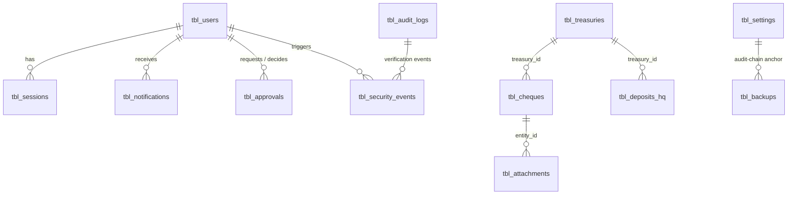

# Collections Management System — Phase 1 + Phase 2

Production Phase 1 + Phase 2 system (live and verified). Phase 2 shipped on 2026-11-19; high-severity security hardening followed on 2026-11-21 (commit `f08b537`).

```text
Frontend → Cloudflare Functions → Repository Interface → Apps Script Adapter → Google Sheets
```

This architecture is unchanged. Business services never access `SpreadsheetApp`; only `apps-script/repository/sheets-adapter.gs` holds Google Sheets access code. Google Sheets remains the single source of truth. The D1 adapter is a reference/contract-test implementation only — it is never bound or selected in production.

## Layout

| Path | Responsibility |
|---|---|
| `frontend/` | Vanilla HTML/CSS/JS SPA served by Cloudflare Pages |
| `functions/` | Cloudflare Pages Functions: middleware, JWT, RBAC, routing, modules |
| `functions/_lib/` | Shared edge libraries + business service modules (`backups.js`, `attachments.js`, `ratelimit.js`, `mfa.js`, …) |
| `shared/` | Constants, enums, repository contract, validation schemas |
| `apps-script/` | Google Apps Script backend (adapter, data definitions, services, migrations, triggers) |
| `apps-script/repository/` | **Only** file permitted to use `SpreadsheetApp` |
| `apps-script/services/` | Domain services (state machines, custody, deposits, alerts, audit, backup) |
| `apps-script/migrations/` | Executable, idempotent M001–M011 migrations + runner |
| `migrations/d1/` | Reference D1 schema (not active in Phase 2) |
| `docs/phase2/` | Phase 2 design, migration, ERD, API, security, config and R2 documents |
| `docs/api/openapi.yaml` | OpenAPI 3.0 spec for Phase 1 + Phase 2 routes |

## Phase 1 scope (live, unchanged)

- JWT-only authentication, RBAC, warehouse/branch scope enforcement
- Customer master read from a separate, daily-updated spreadsheet (system of record)
  - Lookup/autocomplete by Account, Name and الاسم الموحد; 5-minute `customer:{Account}` cache
  - Warehouse Group / Customer group inherited by value onto documents; no local master tables
- Book batches (printing house) with variance + quarantine; books with auto-generated receipts
- Receipts validate Account and inherit customer name, warehouse and department
- Collector custody ledger, balances, reconciliation exceptions
- Collections, branch/HQ deposits with atomic confirmation; cheques (incl. `CLEARING`), guarantees
- Alerts (guarantee 30/15/7/expired, cheque overdue, custody variance) with 01:00 UTC daily scan
- Movements for BOOK/RECEIPT/CHEQUE/GUARANTEE, universal tracking
- Append-only audit, single operational spreadsheet (`sheet_registry` in `tbl_settings`)

## Phase 2 scope (live in production; R2 features skipped)

> **Storage decision:** R2 is skipped. Google Sheets is the primary and only
> production store. Steps 6 and 12 are implemented locally as dormant reference
> code, but their API routes, buckets, secrets and daily backup trigger are not
> part of this rollout. Google Sheets is the only production store.

| # | Feature | Flag / default | Notes |
|---|---|---|---|
| 1 | Audit hash chain | `audit.chainEnabled` — on | `verifyAuditChain()` detects modified, deleted, broken-chain and tail-truncated rows; the chain tip lives in `tbl_settings` |
| 2 | Refresh tokens & sessions | `auth.refreshEnabled` — **on** | 15 min access JWT, 7 day rotating refresh, reuse detection revokes the whole session family |
| 3 | MFA (Email OTP + TOTP) | `auth.mfa.enforce` — **off** | ADMIN/TREASURY support; short-lived `cms-mfa` challenge JWT; salted OTP hashes in KV |
| 4 | Treasury management | `treasury.enforce` — off | `tbl_treasuries`; structured `treasury_id` alongside inherited text fields |
| 5 | Notifications | `notifications.enabled` — **on** | In-app/email/SMS channels, read state and delivery status |
| 6 | R2 attachments | — | **DISABLED** — R2 skipped; reference code and tests only, no routes or bucket |
| 7 | Approval workflow | `approvals.enabled` — **off** | One open request per entity/action, 24 h expiry, self-approval forbidden |
| 8 | Advanced reporting | — | Aging, collector performance, treasury reconciliation, audit exceptions, KPIs |
| 9 | Workbook split support | `registry.splitEnabled` — **off** | CORE/DOCS/AUDIT via registry; activates only when `workbook_registry.enabled` is also true |
| 10 | D1 adapter | `REPOSITORY_ADAPTER` — `sheets` | Reference implementation + contract tests; no binding, never selected |
| 11 | Rate limiting & lockout | — | KV limits on auth/bootstrap paths only, fail-open on KV errors, non-recursive security events, 5 failures → 30 min lock, ADMIN unlock |
| 12 | Backup & recovery | — | **DISABLED** — R2 skipped; GAS ledger code retained for reference, no route or daily trigger |

New tables: `tbl_sessions`, `tbl_treasuries`, `tbl_attachments`, `tbl_notifications`, `tbl_approvals`, `tbl_security_events`, `tbl_backups`. All new columns on existing tables are appended at the end. See the [canonical ERD](docs/phase2/03-erd-changes.md).



## Setup

See **[DEPLOYMENT.md](DEPLOYMENT.md)** for the complete deployment and production test checklist (Apps Script Web App, Script Properties, Cloudflare secrets/KV, bootstrap, migrations and incident response). R2 setup is not part of this rollout.

Quick start:

1. Copy `.dev.vars.example` → `.dev.vars` and fill the Phase 1 secrets. Do **not** add backup secrets.
2. Generate an RSA key pair for JWT (see `.dev.vars.example`).
3. Deploy `apps-script/` as a Web App ("Execute as: Me", access: Anyone — requests are HMAC-signed).
4. Set Apps Script Script Properties: `GAS_SHARED_SECRET`, `CUSTOMER_MASTER_SPREADSHEET_ID`. No backup properties are needed.
5. Set Cloudflare Pages secrets and KV namespace IDs in `wrangler.toml`. No R2 buckets or bindings are required.
6. Call `POST /api/v1/admin/bootstrap` with `X-Bootstrap-Token`, then apply migrations M001–M011 via `migration.run`/`migration.verify`.
7. Deploy: `npm run deploy`. Install only `dailyScanTrigger` (01:00 UTC). `dailyBackupTrigger` is disabled.

### Cloudflare free-tier budget

- `.github/workflows/deploy.yml` only runs on `functions/**`, `frontend/**`,
  `shared/**`, `wrangler.toml` and `package*.json`. Documentation-only commits
  do not consume the 500 Pages builds/month quota; `workflow_dispatch` remains
  available for manual deploys.
- `functions/api/_middleware.js` intentionally performs **no KV write on every
  request**. The former blanket per-IP and `api` counters were removed because
  KV allows only 1,000 writes/day. Limits now apply only to the low-volume
  `login` / `refresh` / MFA / `bootstrap` paths.
- `enforceRateLimit()` degrades open if a KV read or write fails, so quota
  errors can never turn a valid request into a 5xx. A genuine limit breach
  still returns `429 RATE_LIMITED` and records one deduplicated security event.
- Capacity note: ~1,000 collection rows/day (roughly 3,000–5,000 API calls)
  now consumes **zero KV writes on normal API traffic** and stays far below
  the 100,000 Workers requests/day quota.
- No WAF rate-limiting rule is configured: `*.pages.dev` is not a
  customer-owned Cloudflare zone. If a custom domain is proxied through
  Cloudflare later, one free WAF rule can cap `/api/*` by IP with a 10-second
  window without touching KV.

Customer master columns are resolved by header text at read time: `Account`, `Name`, `Warehouse Group`, `Customer group`, `Eligible credit limit`, `Credit limit`, `Balance`, `Payment schedule`, `Worker`, `Worker Name`, `Company chain`, `Segment`, `ID number`, `Telephone`, `Account status`, `الاسم الموحد`.

## Tests

`npm test` — 20 files / 152 tests: repository contract (Sheets + mock D1), schemas, constants, scope (incl. `getInScope`/`guardScope`/`scopeForCreate`), hash chain, sessions/JWT, MFA, treasury, notifications, approvals, reporting, workbook registry, D1 adapter, rate limiting/security, lockout and security-hardening regressions. Attachment and backup suites remain as dormant reference tests; neither feature is deployed.

Production smoke baselines (post-deploy, 2026-11-21): Phase 1 **11/11** (`health`, login, `auth/me`, three dashboard endpoints, customer autocomplete/search/lookup, and both 404 cases) and Phase 2 **11/11** (sessions, reports, notifications, treasuries, approvals, audit, security, registry). Production security check: `/admin/users` projects only public fields (no `password_hash`/`mfa_secret`/`recovery_hashes`) and the flags `auth.mfa.enforce`, `approvals.enabled`, `registry.splitEnabled` remain off. Staging is a fully isolated separate spreadsheet, Apps Script project, Pages project, JWT keys and KV (see `DEPLOYMENT.md` §15); no R2 buckets/bindings/secrets exist in either environment.

Cloudflare-limit mitigation was promoted from staging to production in commit `62d7d9c` (Actions `44900239755`, Pages `16b23c1d`): normal `/api/*` traffic performs **zero KV writes**, KV failures degrade open, and documentation-only commits no longer trigger Pages builds. Post-deploy Phase 1 **11/11**, Phase 2 **11/11**, security check PASS, and `audit.verify` valid with 54 records. See `DEPLOYMENT.md` §14.8 for full evidence.
