# Phase 2 — ERD Changes (Canonical)

**Status:** Implemented locally (Steps 1–12); pending production migration/deployment. The repo had **no formal ERD** in Phase 1; the effective Phase 1 data model is `apps-script/data/tables.gs`. This document is the canonical additive Phase 2 ERD and mirrors the shipped `TABLES` definitions exactly.

> **Rollout update:** R2 is skipped. `tbl_attachments` / `tbl_backups` remain in
> the additive schema, but their R2 objects, checkpoints and backup trigger are
> not used. Audit-chain integrity relies on `tbl_audit_logs` plus
> `tbl_settings.audit_chain_tip`.

---

## 1. Legend and conventions

- Existing Phase 1 tables: solid relationships below. **New Phase 2 tables**: marked `NEW`.
- New columns are **appended at the end** of their table; existing columns are never moved or renamed.
- `warehouse`/`department`/`branch` on documents remain **denormalised text inherited from the external customer master**; they are *not* replaced by the new treasury master. `treasury_id` is an additional structured reference alongside them.
- `CUSTODY_HOLDER_TYPES` values (`COLLECTOR`, `BRANCH_TREASURY`, `HQ_TREASURY`, `BANK`, `LEGAL`, `WAREHOUSE`) are **not** treasuries — only BRANCH/HQ map to `tbl_treasuries`.

---

## 2. New tables

### `tbl_treasuries` (NEW — M004)
| Column | Type/notes |
|---|---|
| `treasury_id` PK | e.g. `TR_HQ`, `TR_BR_56` |
| `treasury_name` | display name |
| `treasury_type` | `BRANCH` \| `HQ` |
| `warehouse` | warehouse code for BRANCH treasuries; blank for HQ |
| `status` | `ACTIVE` \| `INACTIVE` |

### `tbl_sessions` (NEW — M002)
| Column | Type/notes |
|---|---|
| `session_id` PK | UUID, also carried as `sid` claim in the access token |
| `user_id` FK → `tbl_users` | — |
| `refresh_token_hash` | SHA-256 of the opaque refresh token (never store plaintext) |
| `device_info` | user agent / device hint |
| `ip_address` | `CF-Connecting-IP` |
| `created_at`, `expires_at` | 7-day expiry |
| `revoked_at` | set on logout/rotation/reuse-detection |

### `tbl_attachments` (NEW — M005)
`attachment_id` PK · `entity_type` (`CHEQUE`\|`GUARANTEE`\|`DEPOSIT`) · `entity_id` FK (polymorphic) · `file_name` · `r2_key` · `uploaded_by` FK → `tbl_users` · `uploaded_at`.

### `tbl_notifications` (NEW — M006)
`notification_id` PK · `user_id` FK → `tbl_users` · `notification_type` (`GUARANTEE_EXPIRY`\|`CHEQUE_OVERDUE`\|`CUSTODY_VARIANCE`\|`FAILED_RECONCILIATION`) · `entity_type` · `entity_id` · `title` · `body` · `channel` (`IN_APP`\|`EMAIL`\|`SMS`) · `status` (`UNREAD`\|`READ`\|`ARCHIVED`) · `created_at` · `read_at` · `delivery_status`.

### `tbl_approvals` (NEW — M007)
`approval_id` PK · `entity_type` (`HQ_DEPOSIT`\|`CHEQUE_STATUS_CHANGE`\|`GUARANTEE_RELEASE`) · `entity_id` · `action` · `requested_by` FK → `tbl_users` · `requested_at` · `status` (`PENDING_APPROVAL`\|`APPROVED`\|`REJECTED`) · `approver_id` FK → `tbl_users` · `decided_at` · `decision_notes` · `expires_at`.

### `tbl_security_events` (NEW — M008, append-only, protected)
`event_id` PK · `event_type` · `user_id` · `ip_address` · `request_id` · `details_json` · `severity` · `created_at`.

### `tbl_backups` (NEW — M009)
`backup_id` PK · `scope` · `workbook_ids` (JSON) · `r2_key` · `size_bytes` · `checksum` · `status` · `started_at` · `completed_at` · `retention_until` (+90 days).

---

## 3. Modified existing tables

| Table | Appended column(s) | Source of values |
|---|---|---|
| `tbl_audit_logs` | `audit_hash`, `previous_hash` | M001 backfill + every subsequent `AuditService.write()` |
| `tbl_users` | `mfa_enabled`, `mfa_secret`, `locked_until` | M003 default false/blank; enrolment writes secret. `locked_until` added in Step 11: 30-minute lockout after 5 failed passwords; cleared on successful login, expiry or ADMIN unlock |
| `tbl_deposits_branch` | `treasury_id` | M004 backfill from `branch_id`/BRANCH treasury |
| `tbl_deposits_hq` | `treasury_id` | M004 backfill from `hq_reference`/HQ treasury |
| `tbl_cheques` | `treasury_id` | M004 backfill from `current_holder` |
| `tbl_guarantees` | `treasury_id` | M004 backfill from `current_holder` |
| `tbl_movements` | `treasury_id` | M004 backfill from `to_holder_id` |

`tbl_settings` gains new **keys** (not columns): `audit_chain_genesis`, `audit_chain_tip`, `sheet_registry` (extended shape), and all M011 policy flags.

---

## 4. Relationships (Mermaid)

```mermaid
erDiagram
    tbl_users ||--o{ tbl_sessions : "has"
    tbl_users ||--o{ tbl_notifications : "receives"
    tbl_users ||--o{ tbl_approvals : "requests / decides"
    tbl_users ||--o{ tbl_security_events : "triggers"
    tbl_users }o--|| tbl_roles : "role_id"
    tbl_roles ||--o{ tbl_role_permissions : "grants"
    tbl_role_permissions }o--|| tbl_permissions : "permission_id"
    tbl_users ||--o{ tbl_user_scopes : "scope"

    tbl_treasuries ||--o{ tbl_cheques : "treasury_id"
    tbl_treasuries ||--o{ tbl_guarantees : "treasury_id"
    tbl_treasuries ||--o{ tbl_deposits_branch : "treasury_id"
    tbl_treasuries ||--o{ tbl_deposits_hq : "treasury_id"
    tbl_treasuries ||--o{ tbl_movements : "treasury_id"

    tbl_book_batches ||--|{ tbl_books : "batch_id"
    tbl_books ||--|{ tbl_receipts : "book_id"
    tbl_receipts }o--o| tbl_deposit_lines : "receipt_id"
    tbl_deposits_branch ||--|{ tbl_deposit_lines : "deposit_id"
    tbl_deposits_hq ||--|{ tbl_deposit_lines : "deposit_id"
    tbl_collections ||--o{ tbl_receipts : "collection_id"

    tbl_cheques ||--o{ tbl_attachments : "entity_id (CHEQUE)"
    tbl_guarantees ||--o{ tbl_attachments : "entity_id (GUARANTEE)"
    tbl_deposits_hq ||--o{ tbl_attachments : "entity_id (DEPOSIT)"
    tbl_deposits_branch ||--o{ tbl_attachments : "entity_id (DEPOSIT)"

    tbl_alerts ||--o{ tbl_notifications : "type + entity_id"
    tbl_audit_logs ||--o{ tbl_security_events : "verification events (separate chain)"

    tbl_approvals }o--|| tbl_deposits_hq : "HQ_DEPOSIT"
    tbl_approvals }o--|| tbl_cheques : "CHEQUE_STATUS_CHANGE"
    tbl_approvals }o--|| tbl_guarantees : "GUARANTEE_RELEASE"

    tbl_custody_ledger ||--o{ tbl_custody_balances : "holder_id + document_type"
    tbl_reconciliation_exceptions }o--|| tbl_custody_balances : "variance"
    tbl_settings ||--o{ tbl_backups : "settings keys"
```

---

## 5. Workbook placement (after M010 cutover)

| Workbook | Entities |
|---|---|
| **CORE** (existing `12GyV…unLI`) | users, roles, permissions, role_permissions, user_scopes, book_batches, books, receipts, book_assignments, collections, custody_ledger, custody_balances, reconciliation_exceptions, alerts, sessions, treasuries, notifications, approvals, settings, sequences, idx_tracking, idx_id_map, processed_requests, integration_errors |
| **DOCS** (new) | cheques, guarantees, deposits_branch, deposits_hq, deposit_lines, movements, attachments |
| **AUDIT** (new) | audit_logs, security_events, backups |

`sheet_registry` in `tbl_settings` maps each entity → `{sheet, workbookId, workbook}`. `SheetsAdapter.getSheet()` resolves the workbook from this map; business services never change.

---

## 6. Integrity notes

- `tbl_audit_logs` is append-only at the service layer and protected from manual edits. `previous_hash` forms a chain; `audit_chain_tip` in `tbl_settings` anchors the tail.
- `tbl_security_events` is append-only and protected, so `verifyAuditChain()` writes there without extending the chain it checks.
- Polymorphic FKs (`attachments`, `notifications`, `approvals`) are `(entity_type, entity_id)` pairs; referential integrity is enforced in the service layer, not by the sheet.
- No foreign-key constraints exist in Google Sheets; all relationships are logical and enforced by `SheetsAdapter`/services, as in Phase 1.
- **Step 12 external anchor:** each daily backup writes `backups/checkpoints/audit-tip-<date>.txt` to the private R2 backups bucket (180-day retention). Together with `audit_chain_tip` in `tbl_settings`, this makes deletion of the final audit rows (tail truncation) detectable by `verifyAuditChain()` even if `tbl_settings` is also altered.
- `tbl_backups.checksum` is the SHA-256 of the ASCII-escaped JSON snapshot; the edge recomputes it before writing R2 and refuses a mismatched payload. `BACKUP_SIGNING_KEY` HMAC-signs the checksum into object metadata for restore verification.
